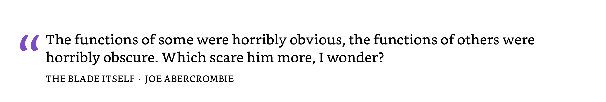
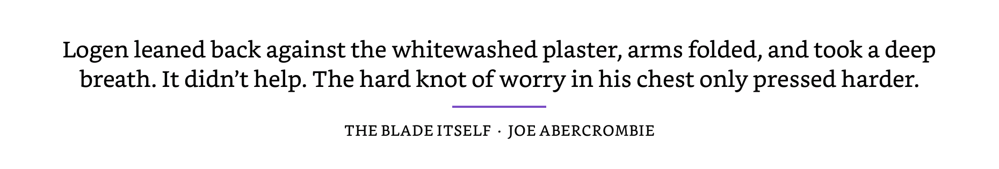
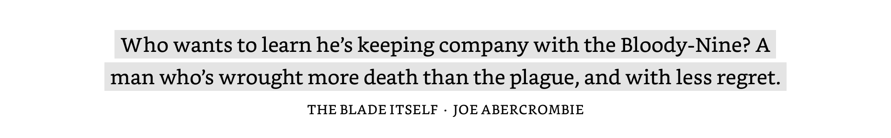
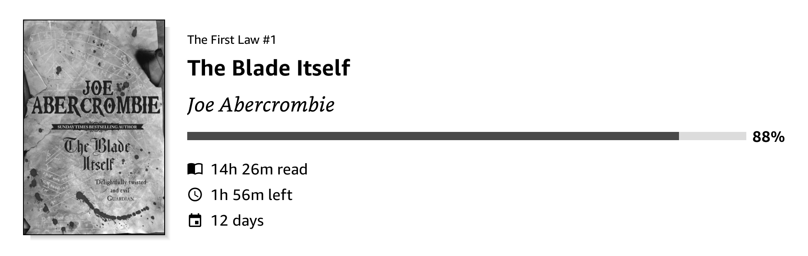

# KOReader.patches

User patches for [SimpleUI](https://github.com/doctorhetfield-cmd/simpleui.koplugin), the home screen and navigation plugin for KOReader.

| Patch | What it adds |
|---|---|
| [`2-simpleui-quote-styles.lua`](2-simpleui-quote-styles.lua) | Three styles for your highlights in the Quote module, and a choice of what the attribution line shows |
| [`2-simpleui-library-sort-last-read.lua`](2-simpleui-library-sort-last-read.lua) | A "Last read" sort and a "Hide Currently Reading book" option for the Flat Library module |
| [`2-simpleui-opds-titlebar-button.lua`](2-simpleui-opds-titlebar-button.lua) | An OPDS catalog button in the Library title bar, next to Search |
| [`2-simpleui-currently-stat-icons.lua`](2-simpleui-currently-stat-icons.lua) | An icon before each statistic line of the Currently Reading module |

## Requirements

- KOReader v2026.07 or newer (tested on v2026.07.2)
- SimpleUI 3.0

Tested on a BOOX Note Air 5C (Android). The patches use only KOReader and SimpleUI code, so they should work on any device SimpleUI runs on.

## Install

1. Download the `.lua` file of the patch you want.
2. Copy it into the `koreader/patches/` folder on your device. Create the folder if it doesn't exist.
3. Restart KOReader.

To remove a patch, delete its file and restart KOReader.

These patches hook into SimpleUI's internal code. A SimpleUI update can rename what they rely on. If that happens, the patch skips itself, writes a warning to KOReader's log (`crash.log` / logcat, lines starting with the patch name) and leaves SimpleUI as it is.

---

## 2-simpleui-quote-styles.lua

Styles for **highlights** in SimpleUI's Quote module (Source: *Your highlights*, *Mixed* or *Custom + highlights*). Built-in and custom quotes keep SimpleUI's own look.

**Epigraph:** a large quotation mark beside the first line.

**Marginalia:** a thin bar beside the quote. Centred, it becomes a short divider between the quote and the attribution.

**Highlighter:** each line on its own highlight block, with a thin gap between lines and balanced line breaks.

### Settings

Long-press the Quote module (or open its settings) to find:

- **Appearance ▸ Highlight style:** Classic (SimpleUI's own look), Epigraph, Marginalia, Highlighter.
- **Content ▸ Attribution:** Book title, Author, Chapter, Date highlighted, Page. Tick any combination; the default is Book title and Author. Parts a highlight doesn't have are skipped, and untick everything to hide the line.

SimpleUI's own Quote settings keep working with every style:

| Setting | Effect |
|---|---|
| Alignment | Left, Centre or Right. Epigraph puts “ beside the first line (Left), above the quote (Centre) or ” on the right (Right). Marginalia puts its bar on the matching side, or a divider when centred. |
| Text ▸ Quote | Font, style and size of the quote. A serif font such as Bookerly or Literata suits these styles best. |
| Text ▸ Author | Font, style, size and colour of the attribution line, which is drawn in letter-spaced capitals. |
| Settings ▸ Style ▸ Accent | Colour of the mark, bar, divider and highlight blocks. Grey when no accent is set. |

The patch also tidies the highlight text: it removes the book's own quotation marks around a highlight, turns a trailing comma into a full stop, and removes stray line breaks and hidden soft hyphens. Chapter, date and page come from the book's KOReader annotations.

---

## 2-simpleui-library-sort-last-read.lua

Two additions to the **Flat Library** home screen module (shown as "Books"):

- **Sort ▸ Last read:** books you opened most recently come first, using KOReader's reading history. Books you haven't opened follow in title order.
- **Hide Currently Reading book:** leaves the book shown by the Currently Reading module out of the Library row, the same option Recent Books has. It appears only while Currently Reading is on the screen, and is off by default.

Both are in the Flat Library module's settings.

---

## 2-simpleui-opds-titlebar-button.lua

An OPDS button in SimpleUI's Library title bar, right after Search, at the same size and spacing.

- **Opens:** the [OPDS Plus](https://github.com/greywolf1499/opds_plus.koplugin) catalog when that plugin is installed, otherwise KOReader's own OPDS catalog.
- **Icon:** `koreader/settings/simpleui/sui_icons/opds.svg` if you have one (icon packs often include it), otherwise KOReader's built-in book icon.

---

## 2-simpleui-currently-stat-icons.lua

An icon before each statistic in the **Currently Reading** module, when its statistics are shown one per line. SimpleUI itself draws a single clock, and only on the one-line (compact) style.

| Statistic | Icon |
|---|---|
| Time read | open book |
| Time left | clock |
| Days reading | calendar |

The icons come from KOReader's built-in symbols font, at the same size and position as SimpleUI's clock, in the colour of the text. The module's **Statistics icon** setting turns them off. Percent, when shown as a separate statistic, gets no icon.

---

## License

GPL-3.0, the same as SimpleUI. See [LICENSE](LICENSE).
