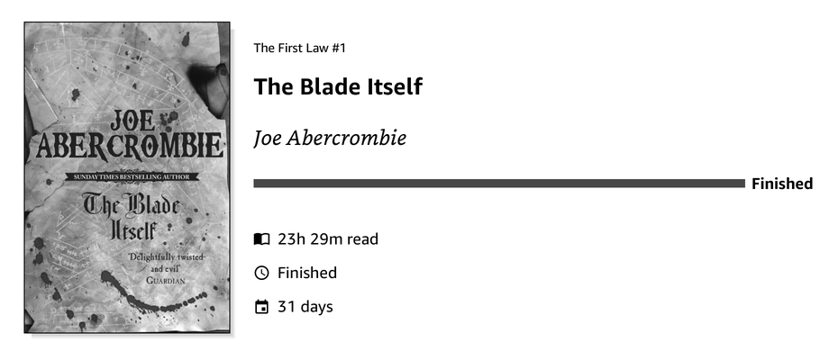
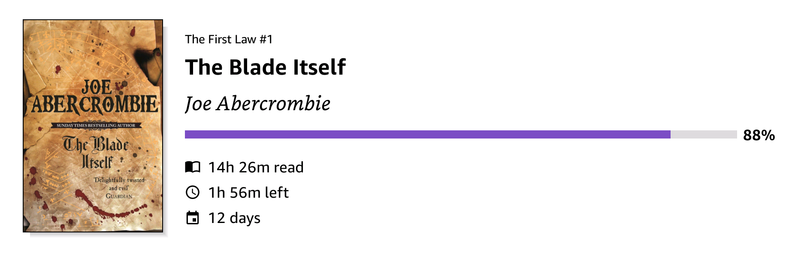

# KOReader.patches

User patches for KOReader, most of them for [SimpleUI](https://github.com/doctorhetfield-cmd/simpleui.koplugin), the home screen and navigation plugin.

| Patch | What it adds |
|---|---|
| [`2-simpleui-quote-styles.lua`](2-simpleui-quote-styles.lua) | Three styles for your highlights in the Quote module, and a choice of what the attribution line shows |
| [`2-simpleui-library-sort-last-read.lua`](2-simpleui-library-sort-last-read.lua) | A "Last read" sort and "Hide books" (current book, or by reading status) for the Flat Library module |
| [`2-simpleui-opds-titlebar-button.lua`](2-simpleui-opds-titlebar-button.lua) | An OPDS catalog button in the Library title bar, next to Search |
| [`2-simpleui-currently-reading-tweaks.lua`](2-simpleui-currently-reading-tweaks.lua) | For the Currently Reading module: an icon before each statistic, a Text Spacing setting (Compact, Fit to Cover), and "Finished" in place of the percentage and time left for a book marked finished |
| [`2-simpleui-series-view-exit.lua`](2-simpleui-series-view-exit.lua) | Fixes leaving a *Group by Book Series* view: the Library tab and the back arrow return to the Library again |
| [`2-swipe-down-opens-menu.lua`](2-swipe-down-opens-menu.lua) | KOReader, no SimpleUI needed: a swipe down anywhere on the page opens the top menu |
| [`2-kindle-scribe-keep-rotation.lua`](2-kindle-scribe-keep-rotation.lua) | Kindle Scribe, no SimpleUI needed: KOReader starts in the rotation it was closed in, not upside down |

## Requirements

- KOReader v2026.07 or newer (tested on v2026.07.2)
- SimpleUI 3.0, for the `2-simpleui-*` patches

Tested on a BOOX Note Air 5C (Android), a Kindle Scribe and a PocketBook Era. The patches use only KOReader and SimpleUI code, so they should work on any device KOReader (and, for the SimpleUI ones, SimpleUI) runs on.

## Install

1. Download the `.lua` file of the patch you want.
2. Copy it into the `koreader/patches/` folder on your device. Create the folder if it doesn't exist.
3. Restart KOReader.

To remove a patch, delete its file and restart KOReader.

These patches hook into SimpleUI's internal code. A SimpleUI update can rename what they rely on. If that happens, the patch skips itself, writes a warning to KOReader's log (`crash.log` / logcat, lines starting with the patch name) and leaves SimpleUI as it is.

---

## 2-simpleui-quote-styles.lua

Styles for **highlights** in SimpleUI's Quote module (Source: *Your highlights*, *Mixed* or *Custom + highlights*). Built-in and custom quotes keep SimpleUI's own look.

**Epigraph:** a large quotation mark beside the first line.

**Marginalia:** a thin bar beside the quote. Centred, it becomes a short divider between the quote and the attribution.

**Highlighter:** each line on its own highlight block, with a thin gap between lines and balanced line breaks.

### Settings

Long-press the Quote module (or open its settings) to find:

- **Appearance ▸ Highlight style:** Classic (SimpleUI's own look), Epigraph, Marginalia, Highlighter.
- **Content ▸ Attribution:** Book title, Author, Chapter, Date highlighted, Page. Tick any combination; the default is Book title and Author. Parts a highlight doesn't have are skipped, and untick everything to hide the line.

With SimpleUI's **Fixed height** on (room for 3 quote lines, shorter quotes centred), the reserved height also counts what each style adds (the large mark, the divider and its gaps, the highlight padding), so a three-line highlight fits in every style and the modules below never move. The patch also drops the Quote module's fixed padding above the quote; the module's **Top Margin** setting sets that space.

SimpleUI's own Quote settings keep working with every style:

| Setting | Effect |
|---|---|
| Alignment | Left, Centre or Right. Epigraph puts “ beside the first line (Left), above the quote (Centre) or ” on the right (Right). Marginalia puts its bar on the matching side, or a divider when centred. |
| Text ▸ Quote | Font, style and size of the quote. A serif font such as Bookerly or Literata suits these styles best. |
| Text ▸ Author | Font, style, size and colour of the attribution line, which is drawn in letter-spaced capitals. |
| Settings ▸ Style ▸ Accent | Colour of the mark, bar, divider and highlight blocks. Grey when no accent is set. |

The patch also tidies the highlight text: it removes the book's own quotation marks around a highlight, turns a trailing comma into a full stop, and removes stray line breaks and hidden soft hyphens. Chapter, date and page come from the book's KOReader annotations.

---

## 2-simpleui-library-sort-last-read.lua

Additions to the **Flat Library** home screen module (shown as "Books"):

- **Sort ▸ Last read:** books you've started come first, most recently read first, using KOReader's reading history. "Started" means some progress, or marked finished or abandoned, so a book you only opened, or whose progress was reset, counts as unread. Books you haven't opened follow, newest added first (the file's date, as SimpleUI's own "Date added" sort), then by title.

- **Hide books:** leave books out of this row: **Current book** (the one the Currently Reading module shows; listed only while that module is on the screen, the same option Recent Books has), **Finished books**, **On-hold books**, **In-progress books**, **Unread books**. Each is off by default and affects only this row; SimpleUI's own Finished Books setting (show, fade, hide) still applies library-wide.

All are in the Flat Library module's settings, under Items.

---

## 2-simpleui-opds-titlebar-button.lua

An OPDS button in SimpleUI's Library title bar, right after Search, at the same size and spacing.

- **Opens:** the [OPDS Plus](https://github.com/greywolf1499/opds_plus.koplugin) catalog when that plugin is installed, otherwise KOReader's own OPDS catalog.
- **Icon:** `koreader/settings/simpleui/sui_icons/opds.svg` if you have one (icon packs often include it), otherwise KOReader's built-in book icon.

---

## 2-simpleui-currently-reading-tweaks.lua

Three changes to the **Currently Reading** module.

**Statistic icons:** an icon before each statistic, when the statistics are shown one per line. SimpleUI itself draws a single clock, and only on the one-line (compact) style.

| Statistic | Icon |
|---|---|
| Time read | open book |
| Time left | clock |
| Days reading | calendar |

The icons come from KOReader's built-in symbols font, at the same size and position as SimpleUI's clock, in the colour of the text. The module's **Statistics icon** setting turns them off. Percent, when shown as a separate statistic, gets no icon.

**Text Spacing** (Appearance ▸ Size ▸ Text Spacing):

| Option | Effect |
|---|---|
| Default | SimpleUI's own spacing |
| Compact | The gaps cut to 40%, and the statistic lines trimmed to their letters |
| Fit to Cover | The spacing adjusted on every draw so the text spans the cover's height, with an even margin above and below (4% of the cover height). Tightened when the text is taller, widened (gaps up to 3×) when shorter |

Fit to Cover applies to the fixed cover layout; with Dynamic Cover Size it behaves as Default.

**Finished:** a book marked finished (KOReader's *Complete*) before its last page kept showing its reading position, e.g. 92%, and a time left. Such a book now gets a full progress bar labelled *Finished*, and *Finished* in place of the time left. A book read to the end without the mark shows 100% as before.

---

## 2-simpleui-series-view-exit.lua

A fix for SimpleUI's **Group by Book Series**. Inside a series group, the Library tab and the title-bar back arrow should take you back to the Library, but in KOReader's cover views the series opens again straight away and the page looks stuck ([simpleui.koplugin#260](https://github.com/doctorhetfield-cmd/simpleui.koplugin/issues/260)).

- **Why:** SimpleUI remembers the open series so it can return to it after a book is closed, and forgets it in a hook on the file browser's `updateItems`. KOReader's cover views (CoverBrowser) replace that function each time the Library opens, so the hook never runs and the refresh after leaving reopens the series.
- **Fix:** going to the series' own folder (Library tab, back arrow, `..`) goes through SimpleUI's own `exitSeriesView()`, which forgets the series first. Nothing else changes.

---

## 2-swipe-down-opens-menu.lua

A plain KOReader patch, no SimpleUI needed: a one-finger swipe down anywhere on the page opens the top menu, so it doesn't have to start at the top of the screen. Useful where a swipe from the very top edge belongs to the system, like Android's notification panel.

- **Takes nothing away:** in page view a one-finger vertical swipe does nothing; page turns stay left and right.
- **Unchanged:** scroll view (vertical swipes still scroll), edge gestures such as frontlight on the left and right edges, KOReader's own top-zone menu swipe, and PDFs and comics.

---

## 2-kindle-scribe-keep-rotation.lua

A plain KOReader patch for the **Kindle Scribe**: KOReader starts the way it was held when it closed. Without it, every start can come up upside down until you turn the Kindle around and back.

- **Why:** KOReader saves the rotation on exit and restores it, but on the Scribe the start-up code then asks the Kindle's window manager for the accelerometer's orientation and uses that instead. The window manager is paused while KOReader runs, so it answers with what the Kindle's own interface last saw (upright), not how you hold it.
- **Fix:** the saved rotation is put back before the first screen. Auto-rotation while you read is unchanged. On any other device the patch does nothing.

---

## License

GPL-3.0, the same as SimpleUI. See [LICENSE](LICENSE).
